<p align="center">
  <a href="https://vibecook-dev.github.io/ghosttea/">
    <picture>
      <source media="(prefers-color-scheme: dark)" srcset=".github/readme/hero-dark.svg">
      
    </picture>
  </a>
</p>

<p align="center">
  <b>A terminal runtime for your app.</b><br>
  Ghostty's terminal core, a Rust daemon, and GPU renderers for Electron and iOS.<br>
  You build the product. ghosttea draws the terminal.
</p>

<p align="center">
  <a href="https://vibecook-dev.github.io/ghosttea/"><b>Website</b></a>&nbsp;&nbsp;·&nbsp;
  <a href="https://vibecook-dev.github.io/ghosttea/api.html">API guide</a>&nbsp;&nbsp;·&nbsp;
  <a href="https://www.npmjs.com/org/vibecook">npm</a>&nbsp;&nbsp;·&nbsp;
  <a href="https://crates.io/search?q=ghosttea">crates.io</a>&nbsp;&nbsp;·&nbsp;
  <a href="CHANGELOG.md">Changelog</a>
</p>

<p align="center">
  <a href="https://github.com/vibecook-dev/ghosttea/actions/workflows/desktop-release-gates.yml"><picture><source media="(prefers-color-scheme: dark)" srcset="https://img.shields.io/github/actions/workflow/status/vibecook-dev/ghosttea/desktop-release-gates.yml?branch=main&label=release%20gates&style=flat-square&labelColor=262624&color=fafaf7"></picture></a>
  <a href="https://www.npmjs.com/package/@vibecook/ghosttea-react"><picture><source media="(prefers-color-scheme: dark)" srcset="https://img.shields.io/npm/v/%40vibecook%2Fghosttea-react?label=npm&style=flat-square&labelColor=262624&color=fafaf7"></picture></a>
  <a href="https://crates.io/crates/ghosttea"><picture><source media="(prefers-color-scheme: dark)" srcset="https://img.shields.io/crates/v/ghosttea?label=crates.io&style=flat-square&labelColor=262624&color=fafaf7"></picture></a>
  <a href="LICENSE"><picture><source media="(prefers-color-scheme: dark)" srcset="https://img.shields.io/badge/license-MIT-fafaf7?style=flat-square&labelColor=262624"></picture></a>
</p>

<br>

<p align="center">
  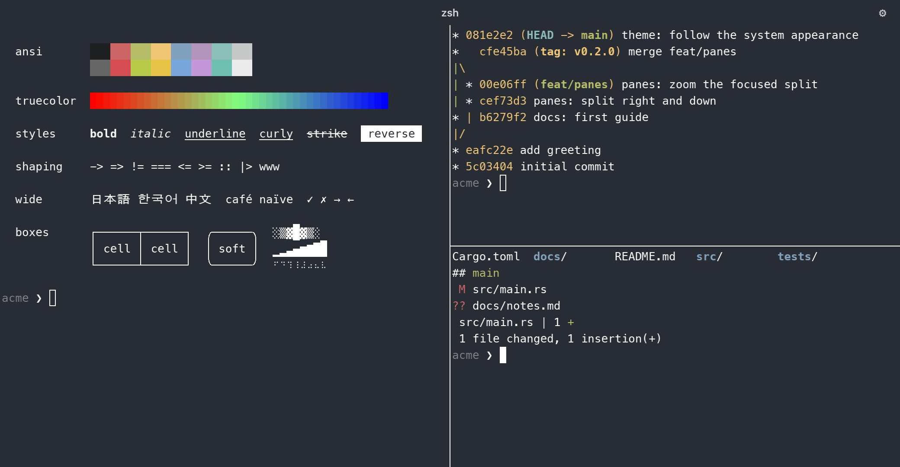
</p>

<p align="center"><sub>The demo app in this repo: three splits in one window, drawn with WebGPU. A screenshot, not a mock.</sub></p>

## Three surfaces

<table>
  <tr>
    <td width="33%" valign="top">
      <picture><source media="(prefers-color-scheme: dark)" srcset=".github/readme/tile-macos-dark.svg">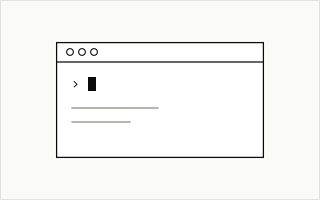</picture>
      <b>macOS</b><br>
      Apple silicon. Electron and React, drawn with WebGPU.
    </td>
    <td width="33%" valign="top">
      <picture><source media="(prefers-color-scheme: dark)" srcset=".github/readme/tile-windows-dark.svg">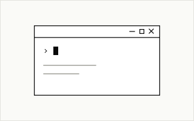</picture>
      <b>Windows</b><br>
      x64. Electron and React, drawn with WebGPU.
    </td>
    <td width="33%" valign="top">
      <picture><source media="(prefers-color-scheme: dark)" srcset=".github/readme/tile-ios-dark.svg">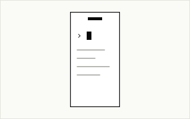</picture>
      <b>iOS 18.1+</b><br>
      Swift, drawn with Metal. Tested on devices; not yet qualified for release.
    </td>
  </tr>
</table>

## Embed it

```bash
npm install @vibecook/ghosttea-electron @vibecook/ghosttea-react @vibecook/ghosttead
```

```ts
// Main process: start the daemon and hand the window its ports
import { GhostteaElectronBackend } from "@vibecook/ghosttea-electron/main";
import { ghostteadPath } from "@vibecook/ghosttead";

const backend = new GhostteaElectronBackend({
  mode: "managed",
  daemon: { binary: { kind: "executable", path: ghostteadPath() } },
});
await backend.start();
window.webContents.on("did-finish-load", () => backend.attachRenderer(window.webContents));
```

```tsx
// Renderer: a whole terminal workspace, with splits
import {
  GhostteaProvider,
  createGhostteaTerminalRuntime,
  waitForGhostteaRendererPorts,
} from "@vibecook/ghosttea-react";
import { GhostteaWorkspace } from "@vibecook/ghosttea-react/workspace";

const runtime = createGhostteaTerminalRuntime({ ports: waitForGhostteaRendererPorts(), platform });

<GhostteaProvider runtime={runtime}>
  <GhostteaWorkspace platform={workspacePlatform} />
</GhostteaProvider>;
```

The preload line and the two small `platform` adapters are in the [API guide](https://vibecook-dev.github.io/ghosttea/api.html). Needs Electron 35 or later and React 19.

## How a frame reaches the screen

<p align="center">
  <picture>
    <source media="(prefers-color-scheme: dark)" srcset=".github/readme/path-dark.svg">
    
  </picture>
</p>

The daemon shapes the text and sends a display list. Your app's main process and your React tree never touch a frame.

## What you get

<table>
  <tr>
    <td width="33%" valign="top">
      <picture><source media="(prefers-color-scheme: dark)" srcset=".github/readme/tile-core-dark.svg">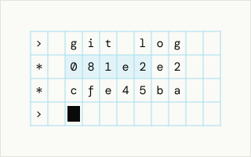</picture>
      <b>Ghostty's core</b><br>
      <code>libghostty-vt</code> 1.0 keeps the state: escape sequences, reflow, selection and scrollback.
    </td>
    <td width="33%" valign="top">
      <picture><source media="(prefers-color-scheme: dark)" srcset=".github/readme/tile-shaping-dark.svg">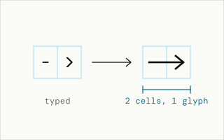</picture>
      <b>Real text shaping</b><br>
      Ligatures and wide characters, shaped natively before they reach the GPU.
    </td>
    <td width="33%" valign="top">
      <picture><source media="(prefers-color-scheme: dark)" srcset=".github/readme/tile-splits-dark.svg">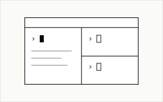</picture>
      <b>A workspace</b><br>
      <code>GhostteaWorkspace</code> gives you splits, zoom and settings. Or place one <code>TerminalSurface</code> yourself.
    </td>
  </tr>
  <tr>
    <td width="33%" valign="top">
      <picture><source media="(prefers-color-scheme: dark)" srcset=".github/readme/tile-config-dark.svg">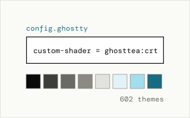</picture>
      <b>Ghostty config</b><br>
      The same file syntax and 602 colour themes. <a href="docs/ghostty-config-compatibility.md">Key coverage</a> is partial.
    </td>
    <td width="33%" valign="top">
      <picture><source media="(prefers-color-scheme: dark)" srcset=".github/readme/tile-automation-dark.svg">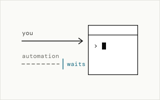</picture>
      <b>Automation that yields</b><br>
      Scripts and agents can type, but their input is refused if a person typed first.
    </td>
    <td width="33%" valign="top">
      <picture><source media="(prefers-color-scheme: dark)" srcset=".github/readme/tile-daemon-dark.svg">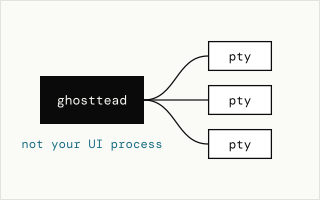</picture>
      <b>A daemon owns the PTYs</b><br>
      <code>ghosttead</code> runs your shells in its own process, on macOS and Windows.
    </td>
  </tr>
</table>

## Shared sessions

<p align="center">
  <picture>
    <source media="(prefers-color-scheme: dark)" srcset=".github/readme/share-dark.svg">
    
  </picture>
</p>

Open a desktop session from another desktop or from an iPhone. The host sends terminal state, so every device draws sharp text at its own size. It travels over your tailnet on [truffle](https://github.com/vibecook-dev/truffle), and your app supplies the truffle sidecar.

## Run the demo

```bash
git clone https://github.com/vibecook-dev/ghosttea.git
cd ghosttea
npm install
npm run fetch:ghostty-vt
npm run dev
```

Needs Node 22 or later and Rust 1.88 or later. The first run compiles the daemon with Cargo.

## Packages

| Need                           | Use                                                       |
| ------------------------------ | --------------------------------------------------------- |
| Complete terminal workspace    | `@vibecook/ghosttea-react/workspace`                      |
| Terminal surfaces in custom UI | `@vibecook/ghosttea-react`                                |
| Electron lifecycle and bridge  | `@vibecook/ghosttea-electron`                             |
| The daemon binary              | `@vibecook/ghosttead`                                     |
| Headless automation            | `@vibecook/ghosttea-client`                               |
| Rust embedding                 | `ghosttea` and `ghosttea-core` on crates.io               |
| iOS                            | `GhostteaKit` through SwiftPM, from this repository's URL |

Ten npm packages, seven crates and the Swift package share one version. [PUBLISHING.md](PUBLISHING.md) lists them all.

## Status

- **macOS and Windows** are release-gated in CI. Prebuilt binaries cover Apple silicon and x64 Windows only: there is no Intel Mac, arm64 Windows or Linux build yet.
- **iOS** is implemented and tested on devices. Release qualification is still open; see the [qualification record](apple/GhostteaKit/Compatibility/release-hardening.md).
- **SSH** exists on iOS only, and is not approved for production yet.
- **Images** (the Kitty graphics protocol) are not implemented.

<br>

<p align="center">
  <a href="https://github.com/jamesyong-42">
    <picture>
      <source media="(prefers-color-scheme: dark)" srcset=".github/readme/james-yong-dark.svg">
      
    </picture>
  </a>
</p>

<p align="center">
  <sub><a href="LICENSE">MIT</a> © 2026 James Yong. ghosttea is a <a href="https://github.com/vibecook-dev">vibecook</a> project, built independently on <code>libghostty-vt</code> and not affiliated with Ghostty. <a href="THIRD_PARTY_NOTICES.md">Third-party notices</a></sub>
</p>
